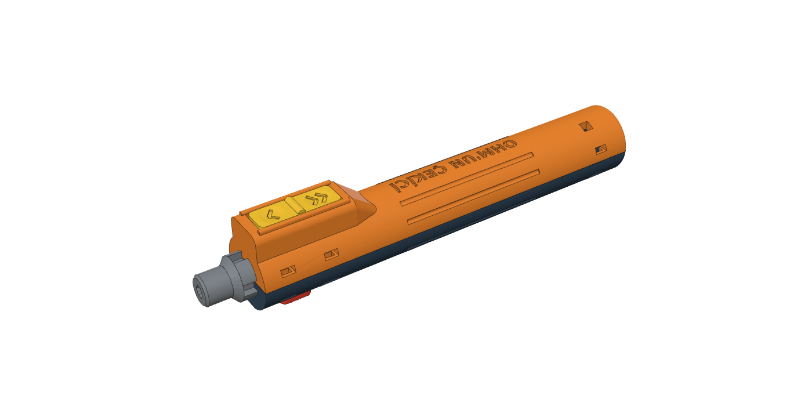
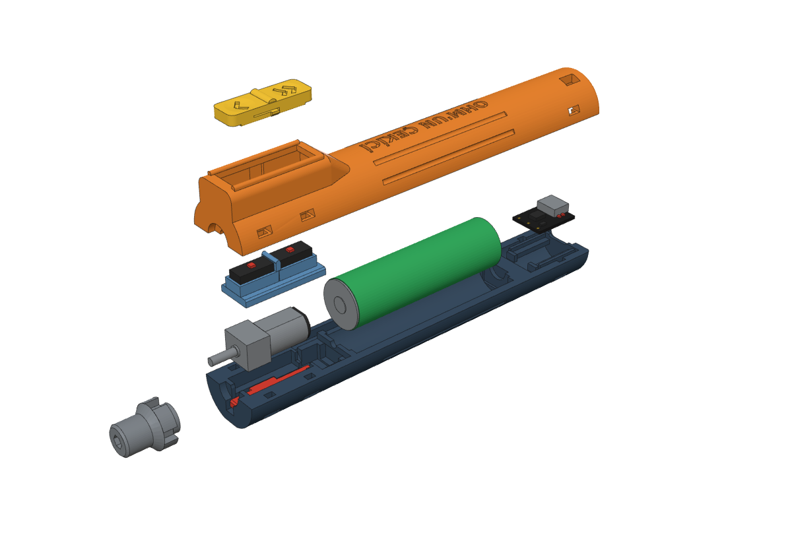
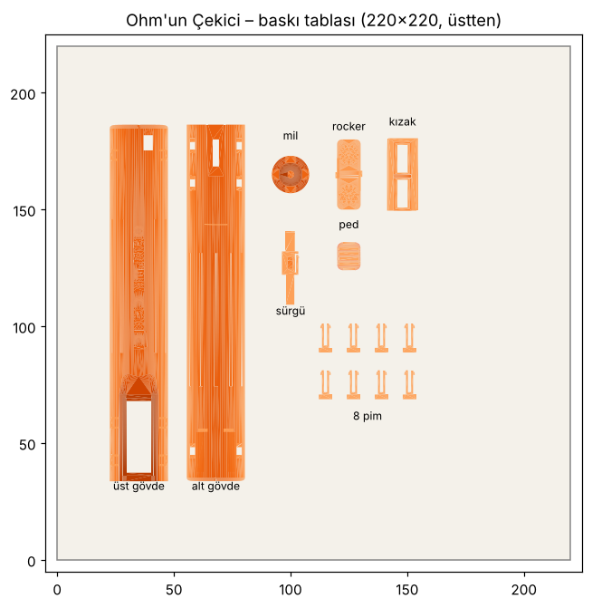
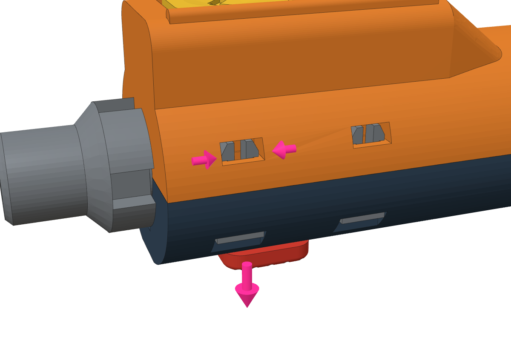

# Ohm'un Çekici

18650 pille çalışan, TP4056 ile şarj olan, vidasız, 3B yazıcıda basılabilen DIY şarjlı tornavida.

## Parçalar

- N20 redüktörlü motor (6 V, 100 RPM), 18650 pil, mini TP4056 (USB-C)
- 3 mikro switch: ileri/geri rocker ve kilit emniyeti
- 6 baskı pim ile vidasız kapanış

## Baskı

`ohm_cekici_tabla.3mf` dosyasını dilimleyiciye at. PLA, 0,2 mm katman, 3 duvar, destek yok.
Mil, rocker, sürgü ve pimler %100, diğerleri %15 dolgu (3MF içinde ayarlı).

## Montaj

Adımlar `montaj_kilavuzu.pdf` içinde. Gövdeyi açmak için pim dişlerini yan pencereden cımbızla sıkıştırıp pimi aşağı çek.

## Dosyalar

- `stl/`, `step/`: parçalar
- `ohm_cekici.py`: parametrik model (CadQuery)

GW Finesse DIY Electric Screwdriver N20 (Printables) tasarımından türetilmiştir. Lisans: CC0.
